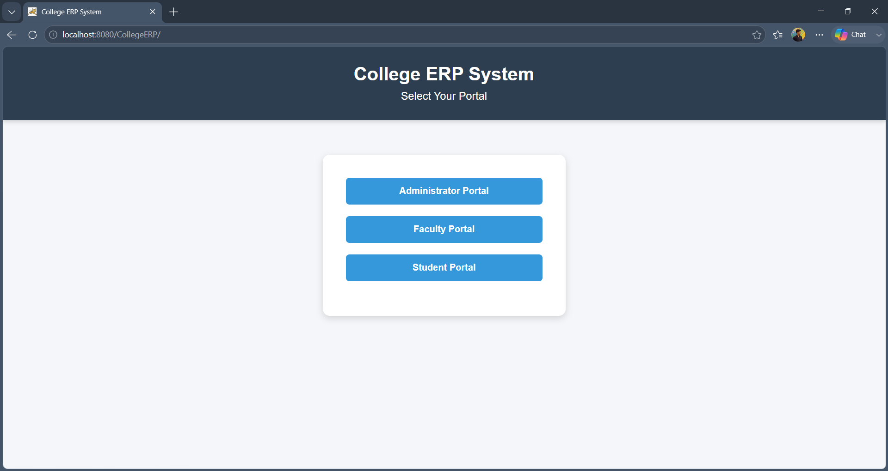
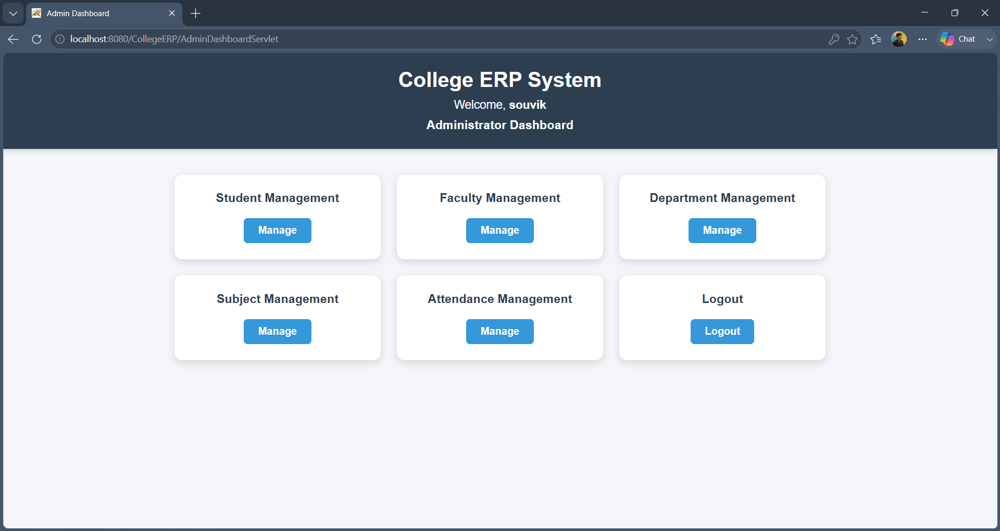
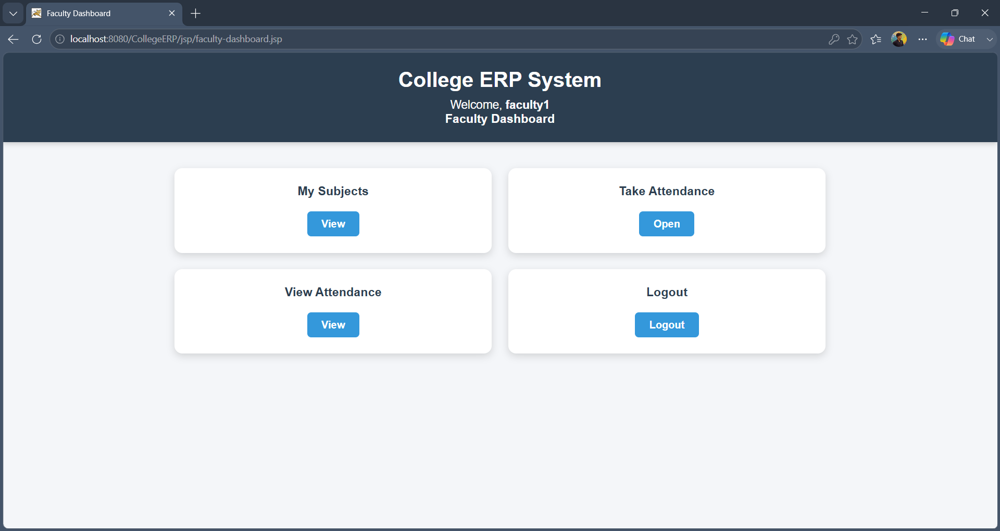
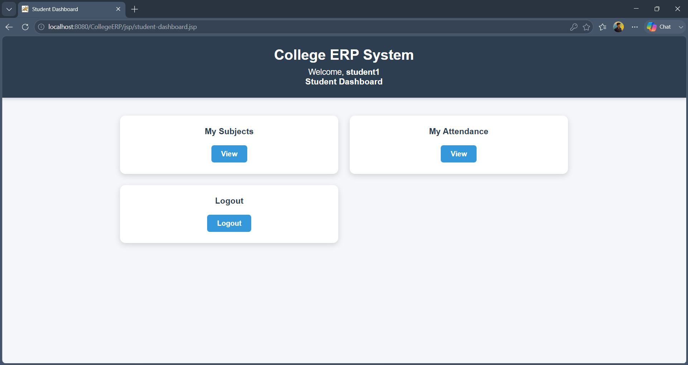
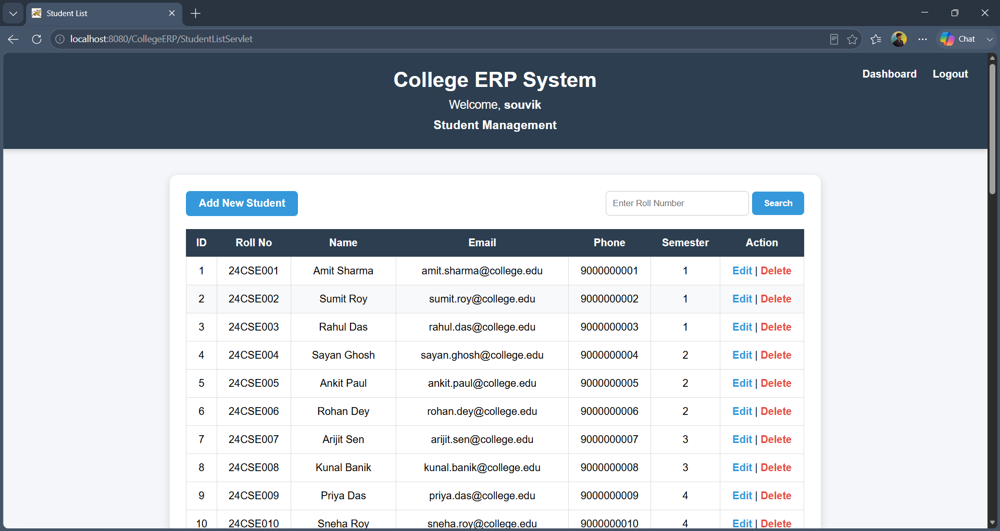
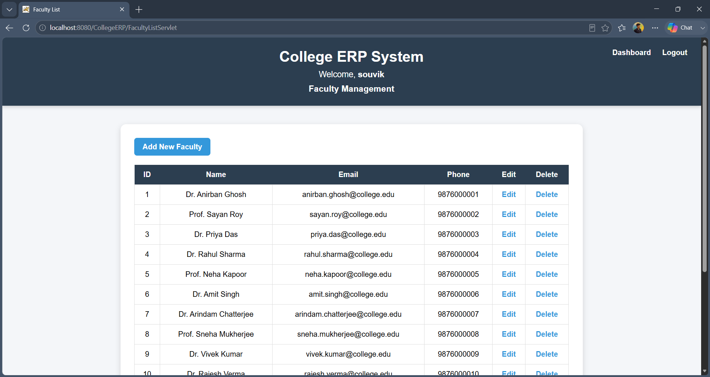
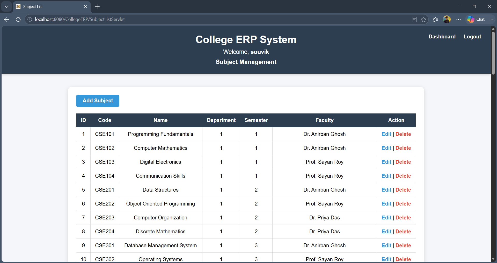
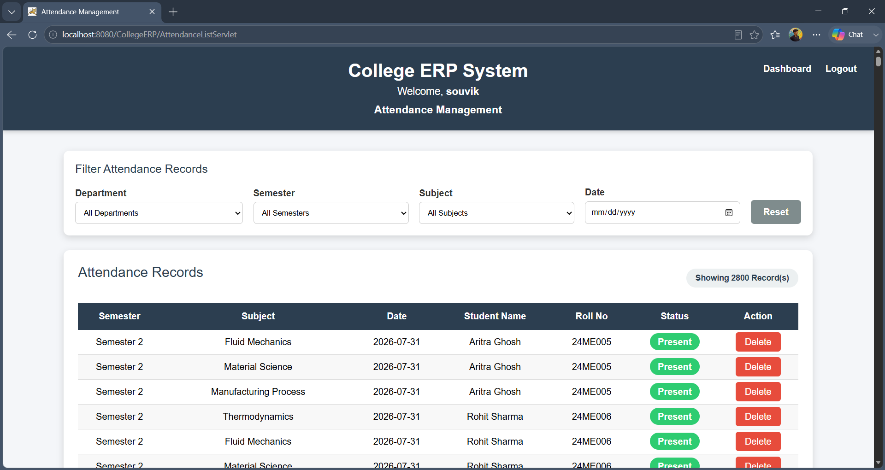
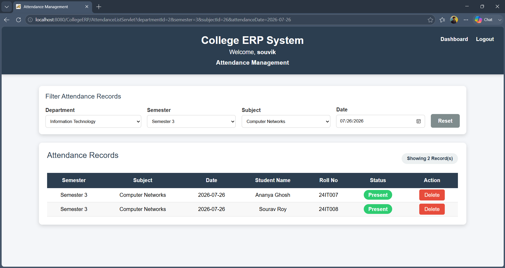

<div align="center">

# 🎓 College ERP System

### A Role-Based College Management Web Application built with Java, Jakarta EE, Servlets, JSP, JDBC, Maven, MySQL & Docker

[](https://college-erp-system-t0l0.onrender.com/)
[](https://www.oracle.com/java/)
[](https://jakarta.ee/)
[](https://www.mysql.com/)
[](https://www.docker.com/)
[](https://maven.apache.org/)
[](LICENSE)

<br/>

**[🌐 Experience the Live Application](https://college-erp-system-t0l0.onrender.com/)**

</div>

---

## 🌐 Live Demo & Portals

The application is deployed on cloud infrastructure (Render + TiDB Cloud Serverless MySQL) and is accessible 24/7:

| Portal | URL | Default Username | Default Password |
|---|---|---|---|
| **🏠 Home Page** | [Open Portal](https://college-erp-system-t0l0.onrender.com/) | — | — |
| **👨‍💼 Administrator** | [Admin Login](https://college-erp-system-t0l0.onrender.com/jsp/admin-login.jsp) | `admin` *(or `souvik`)* | `admin` |
| **👨‍🏫 Faculty** | [Faculty Login](https://college-erp-system-t0l0.onrender.com/jsp/faculty-login.jsp) | `faculty1` *(up to `faculty15`)* | `faculty` |
| **👨‍🎓 Student** | [Student Login](https://college-erp-system-t0l0.onrender.com/jsp/student-login.jsp) | `student1` *(up to `student50`)* | `student` |

---

## 📖 Overview

The **College ERP System** is an enterprise-grade web application designed to digitize and streamline administrative and academic workflows in academic institutions. 

Built with the **Model-View-Controller (MVC)** architectural pattern, the system provides dedicated role-based interfaces for administrators, faculty members, and students with robust session security and granular permission controls.

---

## ✨ Features by Role

### 👨‍💼 Administrator Portal
* **Analytics Dashboard:** Real-time summary statistics for total students, faculty, departments, and course subjects.
* **Department Management:** Full CRUD operations (Add, Edit, View, Delete) for academic departments.
* **Student Administration:** Student enrollment, profile management, and department assignment.
* **Faculty Administration:** Faculty onboarding and profile records.
* **Subject & Curriculum:** Course catalog management with automated departmental associations.
* **Faculty-Subject Assignment:** Allocate faculty members to specific subjects.
* **Attendance Oversight:** Global attendance monitoring with advanced multi-criteria filters (by department, date, student, subject).

### 👨‍🏫 Faculty Portal
* **Personalized Dashboard:** Overview of teaching assignments and active terms.
* **Subject Allocations:** View all actively assigned teaching subjects and enrolled students.
* **Attendance Marking:** Interactive interface to record daily student attendance with composite duplicate protection.
* **Historical Records:** Review and verify past attendance logs with real-time percentage indicators.

### 👨‍🎓 Student Portal
* **Student Dashboard:** Personalized portal showing enrolled department, courses, and notifications.
* **Subject Catalog:** Detailed overview of enrolled semester subjects and credit hours.
* **Attendance Tracking:** Real-time visibility into attendance records and percentage metrics per subject.

---

## 🛠 Tech Stack & Architecture

| Layer | Technology | Description |
|---|---|---|
| **Frontend** | JSP, JSTL, HTML5, CSS3, JavaScript | Dynamic server-side UI rendering with clean responsive layouts |
| **Backend** | Java Servlets (Jakarta Servlet 6.0) | Controller layer orchestrating requests and session validation |
| **Architecture** | MVC (Model-View-Controller) | Separation of business logic, presentation, and data persistence |
| **Data Access** | JDBC (Java Database Connectivity) | Pure JDBC DAO pattern with PreparedStatement SQL injection protection |
| **Database** | MySQL 8.0 / TiDB Cloud Serverless | Relational database with composite keys, cascading rules, and indexes |
| **Security** | BCrypt (`jbcrypt:0.4`) | Secure salted password hashing and role-based session guards |
| **Build & Packaging** | Apache Maven | Automated dependency lifecycle producing standard web archives (WAR) |
| **Containerization** | Docker (Multi-stage build) | Portable packaging with `maven:3.9` and `tomcat:10.1` runtime |
| **Deployment** | Render + TiDB Cloud | Continuous container deployment connected to managed cloud MySQL |

---

## 📂 Project Directory Structure

```
CollegeERP
│
├── Dockerfile                         # Multi-stage Docker container build (Maven + Tomcat 10)
├── pom.xml                            # Maven project definition and dependencies
├── README.md                          # Project documentation
├── .gitignore                         # Version control exclusions
│
├── database/
│   └── college_erp.sql                # Complete schema DDL and pre-seeded production demo dataset
│
├── screenshots/                       # Application UI showcase captures
│   ├── home-page.png
│   ├── admin-dashboard.png
│   ├── faculty-dashboard.png
│   ├── student-dashboard.png
│   ├── student-management.png
│   ├── faculty-management.png
│   ├── subject-management.png
│   ├── attendance-management.png
│   └── attendance-report.png
│
└── src/main/
    ├── java/
    │   ├── controller/                # Jakarta HTTP Servlets (Routing, Auth, CRUD Actions)
    │   ├── dao/                       # Data Access Objects (Raw SQL via JDBC)
    │   ├── model/                     # Java Bean Entities (POJOs)
    │   └── util/                      # DBConnection pool, BCryptUtil security helpers
    │
    └── webapp/
        ├── css/                       # Custom styles
        ├── js/                        # Client-side validation scripts
        ├── jsp/                       # Role-separated view templates
        ├── index.jsp                  # Landing page
        └── WEB-INF/
            └── web.xml                # Servlet context mappings
```

---

## 🗄 Database Design & Pre-seeded Dataset

The database includes a comprehensive schema with relational integrity and seed data:

| Entity | Record Count | Highlights |
|---|---|---|
| **Departments** | 5 | Computer Science, Electronics, Civil, Mechanical, Information Tech |
| **Faculty** | 15 | Profiles linked with user authentication accounts |
| **Students** | 50 | Enrolled students distributed across active departments |
| **Subjects** | 80 | Theoretical and practical courses linked to departments |
| **Faculty-Subject Allocations** | 90+ | Multi-instructor teaching mappings |
| **Attendance Records** | 2,800+ | Pre-calculated daily attendance records with unique composite indexes |
| **Users** | 68 | Role-segregated accounts secured with BCrypt hashes |

---

## 🚀 Local Setup & Installation

### Option 1: Run with Docker (Recommended - 1 Command)

If you have [Docker](https://www.docker.com/) installed, you can build and run the entire stack without configuring NetBeans or Tomcat manually:

```bash
# 1. Clone the repository
git clone https://github.com/Souvik686/college-erp-system.git
cd college-erp-system

# 2. Build the Docker container
docker build -t college-erp .

# 3. Run the container
docker run -p 8080:8080 college-erp
```
Then visit **`http://localhost:8080`** in your browser.

---

### Option 2: Traditional Setup (NetBeans / Tomcat / MySQL)

#### Prerequisites
- **JDK 11 or 17** installed and configured in `JAVA_HOME`
- **Apache Tomcat 10.x** (compatible with Jakarta EE 10)
- **MySQL Server 8.0+**
- **Apache NetBeans** or IntelliJ IDEA

#### 1. Clone the Repository
```bash
git clone https://github.com/Souvik686/college-erp-system.git
```

#### 2. Import Database
Open MySQL Workbench or CLI and run:
```sql
CREATE DATABASE college_erp;
USE college_erp;
SOURCE database/college_erp.sql;
```

#### 3. Database Credentials Configuration
Database settings are externalized. You can either export environment variables:
```bash
export DB_URL="jdbc:mysql://localhost:3306/college_erp"
export DB_USER="root"
export DB_PASSWORD="YOUR_LOCAL_PASSWORD"
```
Or customize the local fallbacks in `src/main/java/util/DBConnection.java`.

#### 4. Build and Run
1. Open the project folder in **Apache NetBeans**.
2. Right-click project → **Clean and Build**.
3. Right-click project → **Run** (ensure Tomcat 10 is selected).
4. Access at: `http://localhost:8080/`

---

## 📸 Application Screenshots

### 🏠 Landing Page


---

### 👨‍💼 Administrator Dashboard


---

### 👨‍🏫 Faculty Dashboard


---

### 👨‍🎓 Student Dashboard


---

### 👨‍🎓 Student Management (CRUD)


---

### 👨‍🏫 Faculty Management


---

### 📚 Subject & Curriculum Management


---

### 📋 Attendance Management & Daily Marking


---

### 📊 Attendance Analytics & Reports


---

## 🔒 Security Best Practices Implemented

* **BCrypt Password Hashing:** User passwords are encrypted with individual dynamic salts using BCrypt before database persistence.
* **SQL Injection Prevention:** 100% of data layer operations execute through parameterized `PreparedStatement` interfaces.
* **Role-Based Access Control (RBAC):** HTTP Session guards enforce role authorization (`role_id: 1=Admin, 2=Faculty, 3=Student`) across all protected endpoints.
* **Database Isolation:** Credentials support externalized environment variable injection for 12-factor cloud deployment.

---

## 👨‍💻 Author

**Souvik Sarkar**  
*Bachelor of Computer Applications (BCA)*  
* GitHub: [@Souvik686](https://github.com/Souvik686)

---

<div align="center">

### ⭐ If this project was helpful, please give it a Star on GitHub!

MIT License • Developed with Java, Servlets, JSP & MySQL

</div>
